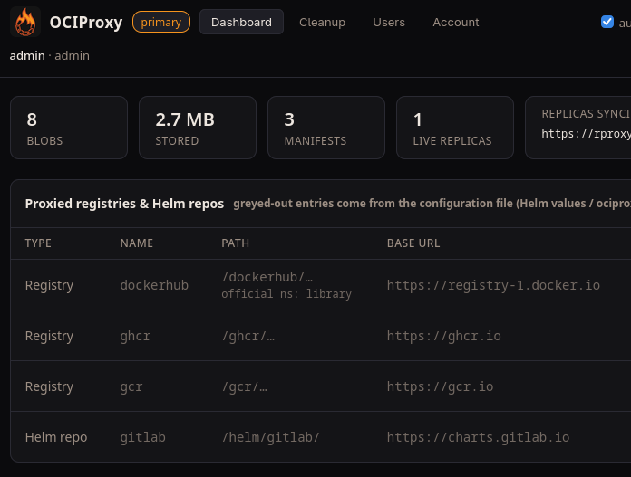

# OCIProxy



[GitHub repository](https://github.com/chainfirelabs/ociproxy)

Cache Docker/OCI images and Helm charts with a primary and optional replicas.

- **Shared:** explicitly public registries and Helm repositories.
- **Independent:** each node's users, passwords, tokens and private repositories.

Upgrading existing storage? Follow the [migration guide](docs/ISOLATION.md#existing-deployments-explicit-offline-migration) first.

## Docker Compose

Starts one primary, two replicas and a separate UI for each node.

```sh
cp .env.example .env
cp ociproxy.toml.example ociproxy.toml
```

Edit `.env`: replace **every** example secret, password and replication token.
Generate each independently with `openssl rand -hex 32`, then start:

```sh
docker compose up --build -d
```

| Node | Registry | Web UI | Password in `.env` |
| --- | --- | --- | --- |
| Primary | `localhost:5000` | http://localhost:8080 | `PUSH_PASSWORD` |
| Replica 1 | `localhost:5001` | http://localhost:8081 | `REPLICA1_PUSH_PASSWORD` |
| Replica 2 | `localhost:5002` | http://localhost:8082 | `REPLICA2_PUSH_PASSWORD` |

Sign in as **`ci`** unless you changed `PUSH_USERNAME`.
The Compose file connects the replicas to the primary automatically.
Add private sources in each node's own UI; they stay on that node.

## Helm

Install **one node per release**. The examples below put both releases in the
`registry` namespace. Use published GHCR builds of both images.

Create `images.yaml` using the GitHub Container Registry paths below. Replace
`YOUR_TAG` with a published tag; the current GitHub workflow builds without publishing:

```yaml
image:
  repository: ghcr.io/chainfirelabs/ociproxy
  tag: "YOUR_TAG"
ui:
  image:
    repository: ghcr.io/chainfirelabs/ociproxy/ui
    tag: "YOUR_TAG"
```

Generate one replication token with `openssl rand -hex 32`. Put the **same token**
in these two files, and keep the completed files out of Git.

`primary.yaml`:

```yaml
replication:
  peers:
    site-a:
      token: "REPLACE_WITH_REPLICATION_TOKEN"
      publish: true
```

`replica.yaml`:

```yaml
primary:
  enabled: false
replica:
  enabled: true
  replicaCount: 1
  primaryUrl: http://primary-ociproxy-primary:5000
replication:
  id: site-a
  token: "REPLACE_WITH_REPLICATION_TOKEN"
config:
  upstreams: []
  helmRepos: []
```

Install the primary, then the replica:

```sh
helm upgrade --install primary charts/ociproxy -n registry --create-namespace \
  -f images.yaml -f primary.yaml
helm upgrade --install replica charts/ociproxy -n registry \
  -f images.yaml -f replica.yaml
```

Each release generates its own local admin credentials. The username defaults to
**`ci`**. Get the replica's password and open its UI:

```sh
kubectl -n registry get secret replica-ociproxy-auth \
  -o jsonpath='{.data.push-password}' | base64 --decode; printf '\n'
kubectl -n registry port-forward svc/replica-ociproxy-ui 8081:8080
```

Visit http://localhost:8081. For the primary, use `primary-ociproxy-auth`
and `primary-ociproxy-ui` instead. For remote clusters, set
`replica.primaryUrl` to the primary's HTTPS address and route `/replication/` to
its registry backend. Leave `ui.primaryUrl` and `ui.nodeUrl` unset.

Using existing Secrets or SealedSecrets? Set `auth.existingSecret` on **each**
release and follow the [Secret examples](docs/SECRETS.md). Each node needs a
different local Secret. `publish: true` lets this replica add public sources;
use `false` to allow consumption only.

## Pull an image

For Compose, or after forwarding the Helm replica registry to port 5001:

```sh
# Helm only: run in another terminal.
# kubectl -n registry port-forward svc/replica-ociproxy-replica 5001:5000
docker pull localhost:5001/dockerhub/library/alpine:latest
```

To share a Docker or Helm source, set **both** `sharing: public` and
`visibility: public` in Helm values (or `sharing = "public"` and
`visibility = "public"` in TOML). Shared sources must allow anonymous upstream
access. New sources default to private/local.

For an existing installation, also read the [OCIProxy naming upgrade notes](docs/RENAME.md).

Use **Cleanup** in each node’s UI to preview cache removal, pin images/charts,
and set retention or disk limits. The primary can request cleanup across public
replicas. See the [cleanup guide](docs/CLEANUP.md).

## More information

- [Helm configuration](docs/HELM.md) and [Secret examples](docs/SECRETS.md)
- [Configuration, accounts and API reference](docs/REFERENCE.md)
- [Isolation and migration](docs/ISOLATION.md)
- [Security review](docs/SECURITY_REVIEW.md)

- [GitLab and GitHub image builds](docs/CI.md)

## License

Copyright (c) 2026 ChainFire Labs LLC. Original code is [MIT licensed](LICENSE).
See [third-party notices](docs/THIRD_PARTY_NOTICES.md) and
[image release requirements](docs/LICENSE_REVIEW.md).
