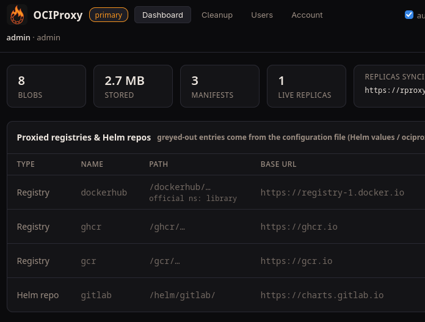

# OCIProxy



[GitHub repository](https://github.com/chainfirelabs/ociproxy)

Cache Docker/OCI images and Helm charts with a primary and optional replicas.

- **Shared:** explicitly public registries and Helm repositories.
- **Independent:** each node's users, passwords, tokens and private repositories.

Upgrading existing storage? Follow the [migration guide](docs/ISOLATION.md#existing-deployments-explicit-offline-migration) first.

## Install with Docker Compose

Each host runs **one node**: a registry and its web UI. Install a primary first,
then add any number of replicas on other hosts. A single primary on its own is
a complete installation.

Both stacks pull the published images `ghcr.io/chainfirelabs/ociproxy:1.0.1` and
`ghcr.io/chainfirelabs/ociproxy/ui:1.0.1`.

### Requirements

- Docker with Compose v2 on each host
- DNS names and trusted TLS certificates for the node's registry and UI
- An HTTPS reverse proxy on the host. The backends listen only on
  `127.0.0.1:5000` (registry) and `127.0.0.1:8080` (UI). See
  [HTTPS and networking](docs/DOCKER.md#https-and-networking) for the routes.

Each node lives in its own folder, holding three files:

| File | Copied from |
| --- | --- |
| `compose.yaml` | `docker/docker-compose.primary.yml` or `docker/docker-compose.replica.yml` |
| `.env` | `docker/.env.primary.example` or `docker/.env.replica.example` |
| `ociproxy.toml` | `ociproxy.toml.example` or `ociproxy.replica.toml.example` |

Docker Compose finds `compose.yaml` and `.env` automatically, so every command
runs inside that folder with no extra arguments. Get the templates once on each host:

```sh
git clone https://github.com/chainfirelabs/ociproxy.git ~/ociproxy-src
```

### Primary

1. Create the node folder:

   ```sh
   mkdir ~/ociproxy-primary && cd ~/ociproxy-primary
   cp ~/ociproxy-src/docker/docker-compose.primary.yml compose.yaml
   cp ~/ociproxy-src/docker/.env.primary.example .env
   cp ~/ociproxy-src/ociproxy.toml.example ociproxy.toml
   chmod 600 .env
   ```

2. Edit `.env`:
   - Set `REGISTRY_PUBLIC_URL` and `UI_PUBLIC_URL` to this node's HTTPS addresses.
   - Replace `OCIPROXY_SECRET` and `PUSH_PASSWORD` with values from
     `openssl rand -hex 32`. Generate each one separately.
   - Set `REPLICATION_PEERS` with one entry and one token per replica. If you
     don't have replicas yet, use `REPLICATION_PEERS='{}'`.

   `ociproxy.toml` lists the sources shared with replicas: Docker Hub, GHCR,
   Quay and Jetstack Helm. Edit it to change them.

3. Start the node:

   ```sh
   docker compose up -d
   ```

### Replica

1. Generate a replication token with `openssl rand -hex 32`. On the **primary**,
   add it to `REPLICATION_PEERS` in `~/ociproxy-primary/.env`:

   ```sh
   REPLICATION_PEERS='{"site-a":{"token":"THE_TOKEN","publish":false}}'
   ```

   Then apply the change from the primary's folder:

   ```sh
   cd ~/ociproxy-primary && docker compose up -d
   ```

2. On the **replica host**, create the node folder:

   ```sh
   mkdir ~/ociproxy-replica && cd ~/ociproxy-replica
   cp ~/ociproxy-src/docker/docker-compose.replica.yml compose.yaml
   cp ~/ociproxy-src/docker/.env.replica.example .env
   cp ~/ociproxy-src/ociproxy.replica.toml.example ociproxy.toml
   chmod 600 .env
   ```

3. Edit `.env`:
   - Set `REGISTRY_PUBLIC_URL` and `UI_PUBLIC_URL` to this node's HTTPS addresses.
   - Set `PRIMARY_URL` to the primary's HTTPS registry address.
   - Set `REPLICATION_ID` to the key you used on the primary (`site-a`), and set
     `REPLICATION_TOKEN` to the same token.
   - Replace `OCIPROXY_SECRET` and `PUSH_PASSWORD` with new values. Never copy
     them from the primary.

   Shared sources come from the primary automatically. `ociproxy.toml` can
   stay empty, or list sources private to this replica.

4. Start the node:

   ```sh
   docker compose up -d
   ```

For more replicas, repeat these steps with a new ID and token for each one.
Set `"publish": true` only for a replica that may add public sources to the shared catalog.

### Check the installation

From the node's folder:

```sh
docker compose ps
docker compose logs --tail=100 registry
```

Open the node's `UI_PUBLIC_URL`
and sign in as **`admin`** (unless you changed `PUSH_USERNAME`), using that
node's `PUSH_PASSWORD`. Create day-to-day users there.

To upgrade, back up the data volume, change both image tags in `.env` to the
same new version, then run `docker compose pull && docker compose up -d`.
Storage, backups and upgrades are covered in the [Docker guide](docs/DOCKER.md).

## Install with Helm

Install **one node per Helm release**: the primary, then one release per replica.
Each node gets its own registry and UI, exposed over HTTPS through Kubernetes
Ingress. The examples use the `registry` namespace,
[ingress-nginx](https://kubernetes.github.io/ingress-nginx/) and existing TLS
Secrets. For other ingress controllers, use the equivalent settings.

### Requirements

- An ingress controller and DNS names for each node's registry and UI
- TLS certificates for those names, as Secrets or issued by cert-manager
- A default StorageClass, or set `primary.persistence.storageClass` and
  `replica.persistence.storageClass`

### Shared values

`common.yaml` sets the images and production defaults for every release:

```yaml
image:
  repository: ghcr.io/chainfirelabs/ociproxy
  tag: "1.0.1"
ui:
  image:
    repository: ghcr.io/chainfirelabs/ociproxy/ui
    tag: "1.0.1"
config:
  # Signed-in users only, unless a source or [access] rule says otherwise.
  defaultVisibility: private
  logFormat: json
  # Start reclaiming cache at 85% disk use, down to 75%.
  gcDiskHighPercent: 85
  gcDiskLowPercent: 75
```

Registry traffic needs large uploads, long timeouts and no buffering. Every
registry ingress below uses these ingress-nginx annotations:

```yaml
nginx.ingress.kubernetes.io/proxy-body-size: "0"
nginx.ingress.kubernetes.io/proxy-read-timeout: "900"
nginx.ingress.kubernetes.io/proxy-send-timeout: "900"
nginx.ingress.kubernetes.io/proxy-request-buffering: "off"
nginx.ingress.kubernetes.io/proxy-buffering: "off"
```

### Primary

Generate one replication token per replica with `openssl rand -hex 32`.

`primary.yaml`:

```yaml
ui:
  publicUrl: https://registry-primary-ui.example.com
replication:
  peers:
    site-a:
      token: "REPLACE_WITH_SITE_A_TOKEN"
      # true only if this replica may add public sources to the shared catalog.
      publish: false
ingress:
  primary:
    enabled: true
    className: nginx
    host: registry-primary.example.com
    annotations:
      nginx.ingress.kubernetes.io/proxy-body-size: "0"
      nginx.ingress.kubernetes.io/proxy-read-timeout: "900"
      nginx.ingress.kubernetes.io/proxy-send-timeout: "900"
      nginx.ingress.kubernetes.io/proxy-request-buffering: "off"
      nginx.ingress.kubernetes.io/proxy-buffering: "off"
    tls:
      - secretName: registry-primary-tls
        hosts: [registry-primary.example.com]
  ui:
    enabled: true
    className: nginx
    host: registry-primary-ui.example.com
    tls:
      - secretName: registry-primary-ui-tls
        hosts: [registry-primary-ui.example.com]
```

```sh
helm upgrade --install primary charts/ociproxy -n registry --create-namespace \
  -f common.yaml -f primary.yaml
```

### Replica

Install each replica as its own release, in the same cluster or another one.
It connects to the primary's public HTTPS registry address.

`replica.yaml`:

```yaml
primary:
  enabled: false
replica:
  enabled: true
  replicaCount: 1
  primaryUrl: https://registry-primary.example.com
  advertisedUrl: https://registry-replica.example.com
replication:
  id: site-a
  token: "REPLACE_WITH_SITE_A_TOKEN"
config:
  # Shared sources come from the primary. List only this replica's private ones.
  upstreams: []
  helmRepos: []
ui:
  publicUrl: https://registry-replica-ui.example.com
ingress:
  replica:
    enabled: true
    className: nginx
    host: registry-replica.example.com
    annotations:
      nginx.ingress.kubernetes.io/proxy-body-size: "0"
      nginx.ingress.kubernetes.io/proxy-read-timeout: "900"
      nginx.ingress.kubernetes.io/proxy-send-timeout: "900"
      nginx.ingress.kubernetes.io/proxy-request-buffering: "off"
      nginx.ingress.kubernetes.io/proxy-buffering: "off"
    tls:
      - secretName: registry-replica-tls
        hosts: [registry-replica.example.com]
  ui:
    enabled: true
    className: nginx
    host: registry-replica-ui.example.com
    tls:
      - secretName: registry-replica-ui-tls
        hosts: [registry-replica-ui.example.com]
```

```sh
helm upgrade --install site-a charts/ociproxy -n registry \
  -f common.yaml -f replica.yaml
```

`replication.id` and `token` must match the primary's `replication.peers` entry
exactly. For more replicas, add a peer with a new token on the primary, run its
`helm upgrade` again, then install another release with its own ID, hostnames
and TLS Secrets.

### Sign in

Each release generates its own bootstrap admin password and keeps it across
upgrades. The username is **`ci`** unless you set `auth.pushUsername`. Read the
password and sign in at the node's `ui.publicUrl`:

```sh
kubectl -n registry get secret site-a-ociproxy-auth \
  -o jsonpath='{.data.push-password}' | base64 --decode; printf '\n'
```

For the primary, use `primary-ociproxy-auth`. Create day-to-day users in each
node's UI.

The values files contain replication tokens, so keep them out of Git. To manage
credentials with your own Secrets or SealedSecrets, set `auth.existingSecret` on
**each** release and follow the [Secret examples](docs/SECRETS.md). Each node
needs a different Secret.

## Pull an image

Pull through any node by putting its registry hostname in front of the image:

```sh
docker login registry-replica.example.com
docker pull registry-replica.example.com/dockerhub/library/alpine:latest
```

Both install methods default to `private`, so clients sign in first. Sources
marked `visibility: public` allow anonymous pulls.

To share a Docker or Helm source, set **both** `sharing: public` and
`visibility: public` in Helm values (or `sharing = "public"` and
`visibility = "public"` in TOML). Shared sources must allow anonymous upstream
access. New sources default to private/local.

For an existing installation, also read the [OCIProxy naming upgrade notes](docs/RENAME.md).

Use **Cleanup** in each node’s UI to preview cache removal, pin images/charts,
and set retention or disk limits. The primary can request cleanup across public
replicas. See the [cleanup guide](docs/CLEANUP.md).

## More information

- [Helm configuration](docs/HELM.md) and [Secret examples](docs/SECRETS.md)
- [Configuration, accounts and API reference](docs/REFERENCE.md)
- [Isolation and migration](docs/ISOLATION.md)
- [Security review](docs/SECURITY_REVIEW.md)
- [GitLab and GitHub image builds](docs/CI.md)

## License

Copyright (c) 2026 ChainFire Labs LLC. Original code is [MIT licensed](LICENSE).
See [third-party notices](docs/THIRD_PARTY_NOTICES.md) and
[image release requirements](docs/LICENSE_REVIEW.md).
